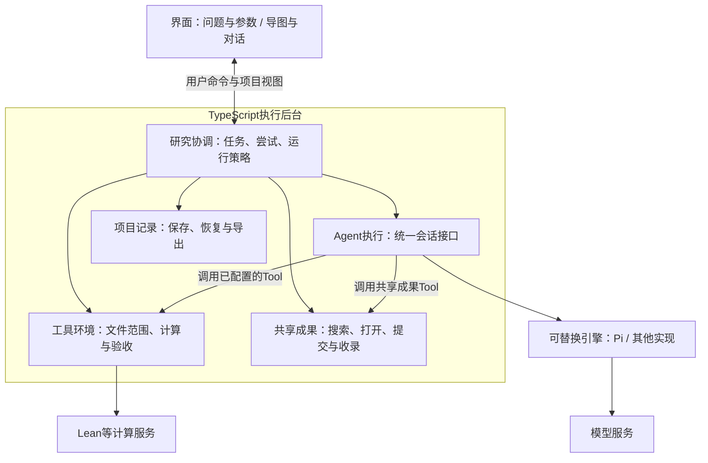

# 整体架构：稳定的任务核心与可替换的执行方式

日期：2026-10-24。状态：整体设计建议，未实现或压测。用户要求后端使用TypeScript，先完成数学，并考虑以后改用Pi、其他领域及“同一问题尝试100次”的运行方式。本文按John Ousterhout的《软件设计的哲学》（A Philosophy of Software Design）理解用户所指书名。

## 设计依据

作者的[书籍说明](https://web.stanford.edu/~ouster/cgi-bin/book.php)、[官方节选](https://web.stanford.edu/~ouster/cgi-bin/aposd2ndEdExtract.pdf)及[CS190课程讨论提纲](https://web.stanford.edu/~ouster/cs190-winter24/lectures/aposd/)强调深模块、信息隐藏，以及通用能力与专用行为的边界。以下架构是将这些原则用于本项目后的建议，不是书中指定的框架。

| 原则 | 在本项目中的应用 |
| --- | --- |
| 深模块 | 对外提供完整能力，如“运行一次尝试”“提交一个模块”“导出一个项目”；模块内部承担上下文、排队、版本和错误处理 |
| 信息隐藏 | 把模型协议、引擎会话格式、路径解析和导出格式放在各自模块中，其他模块通过约定的能力使用它们 |
| 适度通用 | 核心使用任务、尝试、产物、验证等概念；Lean命题、物理模拟和生物分析的具体规则放在领域配置与工具中 |
| 按需要共同变化的知识划分 | 会话续接与会话格式一起设计；文件范围与文件操作一起设计；原始记录、快照和导出一起设计 |

模块数量以减少调用方需要理解的细节为准。首版采用一个可打包的应用和一个TS执行后台，后台按职责分模块；模块之间先用进程内接口协作。进程拆分只由界面生命周期、所选引擎或计算方式决定。

## 总体关系

图中表示主要职责关系。共享成果整理需要执行Agent时，由研究协调模块创建整理任务，再交给Agent执行模块。成果库本身不实现另一套Agent循环。执行记录也通过约定接口交给项目记录模块保存。

Electron、React、React Flow仍为[桌面GUI候选](gui-and-model-access.md)，尚未选定。业务后台独立于窗口代码；以后放到服务器上时，主要增加连接与部署适配。

首版引擎仍待比较。Pi直接嵌入与Mastra运行管理两种接法、各自需要自建的内容，以及恢复和上下文分支的限制，见[Pi与Mastra比较](pi-vs-mastra.md)。本轮不锁定引擎或引入依赖。

## 五个后台模块

| 模块 | 对外承担的能力 | 内部负责、避免向外扩散的细节 |
| --- | --- | --- |
| 研究协调 | 建立问题、分配任务、开始/暂停尝试、调整方向、执行汇报与整理流程、提供项目视图 | 任务归属、协作或独立尝试策略、预算与并发额度、流程衔接 |
| Agent执行 | 建立/续接会话、发送任务与纠偏、读取进展、分出汇报调用、停止执行 | 引擎接入、上下文构造、模型请求、流式事件、引擎原生会话格式 |
| 工具环境 | 在授权范围读写文件、调用计算、取得绑定文件版本的验收证据 | 路径与权限检查、输入传输、外部作业状态、输出回收、领域验收实现 |
| 共享成果 | 搜索、只读打开固定版本、submit_skill、收录可用目录 | 模块索引、版本、来源、重复内容合并和发布权限 |
| 项目记录 | 持续保存记录、读取历史、创建一致快照、恢复与导出 | 正文与文件布局、查询索引、格式版本、完整性检查和打包 |

研究协调负责业务决定的落地，但不实现模型通信、文件路径检查或ZIP格式。Agent执行负责单个会话怎么运行；一百次尝试如何分配由研究协调决定。引擎内部的自动重试也必须受项目额度约束，不能形成另一套绕过限制的请求调度。

任务、会话、产物分别有稳定标识。它们之间保留关联，但不强制“一次尝试永远等于一个会话”：一次尝试可能需要暂停续接，或有独立的汇报调用。

## 四个相互独立的替换点

| 想改变什么 | 应修改哪里 |
| --- | --- |
| 换成Pi或另一种Agent框架 | Agent执行模块中的引擎适配，必要时增加上下文转换 |
| 换模型、地址或服务商 | 引擎使用的模型配置与服务适配 |
| 从分方向协作改为“抽100张卡” | 研究协调中的运行策略与成果共享规则 |
| 从数学改为编程、物理或生物 | 领域任务说明、Tool集合、计算资源和验收规则 |

Pi是执行引擎，DeepSeek是模型，两者属于不同选择。未来不同角色可以采用不同引擎，但首版只需接通一个实现；第一版引擎尚未确认。本轮不预先实现多个引擎、插件市场或通用工作流语言。

领域规则不只是工具名字。数学可以验证Lean声明和依赖；编程可以运行任务指定的测试；物理计算需要明确模型、单位、误差及复现条件；生物分析需要明确输入数据、方法和质量指标。系统保留各领域证据，不把所有领域都解释为数学意义上的“已证明”。

## 主Agent与程序的边界

主Agent是研究协调中的一个角色。它理解用户问题、查已有成果、提出和分配方向，逐个检查子Agent的对话、执行状态与文件，并做路线调整。它通过项目Tool操作这些能力。

程序负责可靠执行这些决定：检查权限与额度、登记任务、安排请求、保存记录、触发默认20分钟汇报和更新界面。主Agent的方向判断不能代替程序权限，模型说“证明完成”也不能代替验收证据。

主管、证明、汇报和整理复用同一套会话执行能力。角色通过任务说明、上下文、Tool和文件范围区分。整理仍是一个独立Agent加一个独立工作区，具体共识见[汇报与成果图流程](reporting-workflow.md)。

## 分方向协作与100次尝试

系统以“问题—任务—尝试—产物—验证记录”组织工作。当前数学流程按方向分组，主Agent可根据进展继续拆分和纠偏。

“抽100张卡”可以作为另一种运行策略：对同一份冻结输入建立100次尝试，各自保留会话、工作区、参数、产物及验收结果。完成后根据领域规则筛选结果。100次尝试是计划数量，实际同时运行多少仍由模型与计算额度控制。

独立尝试时，其他尝试的中途答案默认不注入当前会话，避免所有尝试过早沿同一路线收敛。若选择共享成果，则按协作策略记录共享内容及版本。不同会话并不保证统计独立，不能仅凭尝试次数承诺成功率。

初版只实现当前数学所需的协作流程，并在数据中保留尝试和策略的边界；无需同时交付所有搜索算法。

## 汇报、整理和界面如何接上

原始对话与Tool结果持续保存。默认每20分钟，程序取得工作会话的一个确定上下文截止点，复用已有上下文，末尾追加一句结构化汇报要求；原证明会话继续。分出汇报的具体实现由引擎适配承担，不要求界面理解引擎的会话树，也不承诺复制服务端KV缓存。

证明Agent做子问题前先搜索共享成果。有新子证明时，submit_skill把对应目录的确定版本交给独立整理Agent。整理Agent比对已有内容，尽可能直接修正、验证并组织成可用文件夹，返回目录和结构化结果；不会默认把日常整理退回原证明Agent。

可用成果经受信流程收录后，研究协调记录成果与尝试的关系，界面在对应分支末端增加节点。没有新证明时只更新进度与运行信息。导图显示项目记录中的事实；布局、缩放和选中状态由界面负责，数学依赖与成果时间顺序分别保存。

## Pi接入必须保留的边界

[Pi官方SDK文档](https://github.com/earendil-works/pi/blob/main/packages/coding-agent/docs/sdk.md)提供程序化会话、自定义工具和事件接口，可作为TS后台的候选接入方式；尚未完成本项目集成或实测。

Pi接入时仍只能取得本项目授予的Tool和文件范围。指定cwd只是工作目录选择，不能当作文件权限隔离。数学阶段由项目提供受限文件Tool及计算Tool，控制资源发现和默认工具加载，不自动继承个人全局扩展、通用终端和任意文件权限。具体接口应在实施时针对选定版本核验。

模型请求与计算作业分别受限，不为每个逻辑Agent常驻一个终端、语言服务器或虚拟机。百会话的实际容量仍需后续测量。

## 记录与导出的稳定边界

项目记录保留可读的任务、对话、Tool、报告、产物及验证关联，并按需保存引擎原生会话资料。应用自身的项目格式不直接等同于某个引擎的会话格式。

同引擎恢复可以利用原生资料；跨引擎续接使用目标引擎能接受的上下文、任务和文件。若目标引擎不能无损表达某些原生内容，应保存原件并说明转换范围，不能承诺直接导入就完全等价。凭据与服务端缓存仍不属于可迁移保证。

[记录与导出方案](records-and-export.md)继续采用一题一目录、暂停后创建一致快照和项目ZIP。成果库的实际引用版本随包携带，导图可从保存的项目状态恢复。

## 首版收敛范围

首版接通一个引擎、一套数学工具与验收规则，以及一条真实的任务—执行—汇报—整理—图更新—导出链路。题库仍为The Last Math Competition。先验证少量真实尝试，再扩大到约100个会话；引擎替换、其他领域和新的搜索方式逐项验证。

架构边界是否合适，后续可以用三个变化来检查：换模型时是否需要改图；换Pi时是否需要重写成果库；换学科时是否需要修改通用记录与导出流程。这些变化应主要落在对应适配部分。具体类型、通信协议、数据库表和模块内部目录留到实现前设计。

## 来源与核验范围

2026-10-24核验作者书籍说明、公开节选的索引内容、官方CS190讨论提纲和Pi官方SDK说明。官方节选PDF较大，浏览工具未完整读取，不声称本轮通读全书。采用的是上述可核验原则，模块划分与技术选择为本项目的设计推导。

- [作者书籍说明与官方节选入口](https://web.stanford.edu/~ouster/cgi-bin/book.php)
- [作者公开节选：通用模块与专用行为](https://web.stanford.edu/~ouster/cgi-bin/aposd2ndEdExtract.pdf)
- [CS190：书中主要设计概念讨论提纲](https://web.stanford.edu/~ouster/cs190-winter24/lectures/aposd/)
- [Pi官方SDK](https://github.com/earendil-works/pi/blob/main/packages/coding-agent/docs/sdk.md)

本轮只更新设计文档，没有安装依赖、启动Agent、执行Lean、生成项目导出包或运行并发与跨引擎测试。
