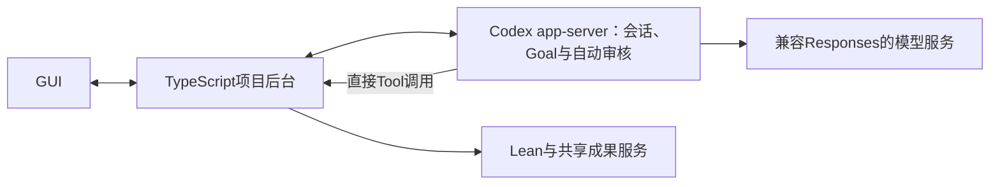

# Codex与Claude Code：模型、持续目标与接入

日期：2026-10-24。状态：用户已改选Codex，停止推进Pi首版方案；下述app-server接法为设计建议。只做文档核验，尚未启动服务、接入模型或运行证明。

## 当前决定

用户希望减少运行时自建工作。首版采用Codex，不继续拼装Pi Goal和权限插件。TypeScript后台通过Codex app-server管理会话和业务Tool；GUI继续保留参数页、成果导图与主管对话。原Pi调研留作历史参考。

Codex是执行引擎，模型厂家可以另配。选择Codex不表示改用OpenAI模型；用户指定的OpenCode Go和DeepSeek V4.1 Flash仍保留为接入要求，兼容性尚未解决。

## Claude Code与Codex的关键差别

两者都有原生持续目标和自动权限审核，不能把Claude Code描述成必须自己写循环。Claude Code的[Goal机制](https://code.claude.com/docs/en/goal)在每轮结束后调用独立的小模型，读取条件和当前对话，判断继续、完成或不可能；评估器没有工具，不能自行复验Lean。支持非交互运行及恢复活动目标，但恢复会重置本次计时、轮数和用量基线。

Codex的Goal属于持久线程状态，并已通过app-server提供管理接口。两者默认完成机制都不是本项目的受信Lean验证器，两者也都不能仅凭现成Goal保证特定三轮阻塞规则。

[Claude Agent SDK](https://code.claude.com/docs/en/agent-sdk/overview)同样能供TypeScript产品调用，并提供[会话恢复及分支](https://code.claude.com/docs/en/agent-sdk/sessions)，因此“做自己的GUI”不是Codex独有能力。当前文档中的自定义Tool标准接法是[进程内MCP封装](https://code.claude.com/docs/en/agent-sdk/custom-tools)，无需另起网络服务；与本项目希望直接配置Tool的接法仍有接口差异。

Claude Code的自动审核可以选择分类器模型，但可用性受版本、主模型、provider和组织配置限制；设置分类器名字不能证明任意非Claude主模型得到官方支持。OpenCode文档提供部分非Claude模型接法，而Anthropic明确不支持通过网关路由非Claude模型。OpenCode的Claude Code页笼统列出DeepSeek V4，没有在该页明确到用户指定的deepseek-v4.1-flash；不能推断其完整兼容。技术可接、官方支持、Goal与自动审核一起可用，必须分别判断。

当前更倾向Codex的依据是其app-server明确暴露线程和Goal管理，便于作为本项目后台；不是已经证明Codex接DeepSeek更容易。若继续比较，应以同一个指定模型的真实Tool、Goal和审核链路为依据，不以聊天体验或功能名称决定。

## 接入关系

app-server是可供自建应用调用的服务接口，不需要操作Codex桌面窗口，也不要求每个工作Agent启动一个CLI。一个服务管理多个线程为拟采用方式，实际容量与全局额度控制仍需验证。

## 已核验的现成能力

[官方app-server文档](https://learn.chatgpt.com/docs/app-server)已列出下列接口。本项目尚未调用这些接口：

| 项目需要 | 已有接口或机制 | 本项目保留的工作 |
| --- | --- | --- |
| 创建、查看和恢复Agent | thread/start、thread/list、thread/read、thread/resume及状态事件 | 任务与线程关联、主管查看范围 |
| 持续工作目标 | thread/goal/set、get、clear及Goal更新事件 | 明确数学目标、验收条件与主管任务分配 |
| 定时独立汇报 | thread/fork支持按已完成turn确定截止点 | 默认20分钟触发；汇报禁用继承的Goal及自动续做，限制写权限 |
| Lean与共享成果Tool | dynamicTools及item/tool/call | Tool输入校验、文件范围、执行和结果返回 |
| 历史与界面 | 分页历史、流式消息及线程状态 | 结构化报告、成果图、项目快照与导出 |

dynamicTools当前为实验接口，需要显式启用并锁定所用版本。它满足本项目直接Tool调用的方向，不引入MCP。API存在不等于默认关闭了其他内置工具，也不等于自定义Tool自动经过Auto-review；工具集合和权限范围仍要单独核验。

## 原生Goal怎么持续工作

[官方Goal说明](https://developers.openai.com/cookbook/examples/codex/using_goals_in_codex)将目标作为线程持久状态，记录目标、生命周期和用量。在一轮工作结束后，线程空闲、没有待处理输入且目标仍活动时，运行时安排续做。暂停、预算或阻塞会改变是否继续；空转也有抑制规则。

数学场景沿用同一线程和文件：读取当前目标 → 搜索引理或写证明 → 调用Lean → 根据诊断继续。普通回复结束不直接意味着整个目标结束。项目不另加一个“每轮发送继续”的循环，也不再安装Pi Goal插件。

模型提出完成与项目认可证明成立仍分开。Lean验收须绑定冻结命题、文件版本和环境，并排除未批准的信任扩展；Goal完成状态不能单独把图节点标为已证明。同一Goal连续三轮自主排障仍受阻才交给主管的业务要求保留，不能将权限审核的三次拒绝熔断误当成该规则。具体事件和宿主能否直接强制此规则，尚未验证，不提前承诺零适配。

## 原生Auto-review能省掉什么

[官方Auto-review说明](https://learn.chatgpt.com/docs/sandboxing/auto-review)提供独立审核Agent，处理原本需要人工审核的合格请求。它保留原来的沙盒和权限边界；已允许的普通操作不逐项送审。

规划上复用这套机制，不自建权限判官。配置需同时满足合格的approval policy和自动reviewer选择；禁用审核提示不等于启用Auto-review。它审查操作授权与风险，不验证Lean数学正确性。

当前官方资料未据此证明“任意第三方主模型、任意第三方审核模型、全部自定义Tool”都能原样一起使用。因此外接提供商后的reviewer模型来源、认证、故障行为与实际覆盖面，是第一条小链路必须核验的内容。

## OpenCode模型接入的实际门槛

[Codex官方配置](https://learn.chatgpt.com/docs/config-file/config-reference)支持自定义provider、地址及凭据来源；自定义provider的wire_api目前只支持responses。[OpenCode的Codex接入页](https://opencode.ai/v2/docs/console/harnesses/codex/)也提供Console和Go配置，并限定到提供Responses接口的模型。

[Go模型表](https://opencode.ai/v2/docs/console/go/)当前给deepseek-v4.1-flash列出的接口为chat/completions。它与Codex要求的协议不同，不能只换Base URL就认定能直接用。保留该模型要求，先确认服务是否另有可用Responses接口；若没有，再评估现成协议适配器，不自行改模型或立即开发网关。

协议适配必须保留流式Tool调用、工具结果关联、错误和用量语义；仅能返回一句文本不算Agent接入成功。本文未测试适配器，未验证账户访问或批量科研流量额度，也未发送推理请求。

## 本轮比较留下的结论

| 方案 | 持续目标与权限审核 | 模型接入与本项目代价 |
| --- | --- | --- |
| Pi | Goal和自动权限审核主要借助所选社区扩展，需处理版本与宿主集成 | 官方支持多种API及OpenCode Go；用户认为自建工作过多，已不采用 |
| Codex | 原生Goal、Auto-review、线程管理可复用 | app-server便于自建界面；外部provider需符合Responses，审核组合待验证；用户已选定 |
| Claude Code | 官方已有/goal和auto模式；Goal评估读取会话内容，不独立执行Lean | 网关使用Anthropic Messages等规定协议；Anthropic不支持经网关路由非Claude模型，不能承诺任意厂家功能等价 |

Pi依据其[模型文档](https://github.com/earendil-works/pi/blob/main/packages/coding-agent/docs/models.md)、[OpenCode Pi接入说明](https://opencode.ai/v2/docs/console/harnesses/pi/)和已归档[Goal源码调研](pi-goal-implementations.md)。Claude Code依据[Goal文档](https://code.claude.com/docs/en/goal)、[权限模式](https://code.claude.com/docs/en/permission-modes)及[网关支持边界](https://code.claude.com/docs/en/llm-gateway)。OpenCode另有部分非Claude模型的接入说明，与Anthropic官方支持范围应分开，不将两者合并为功能保证。

## TS封装如何承接项目流程

用户进一步将讨论收窄到Codex与Claude Code的封装：每个工作会话用自己的Goal执行任务，TS管理并发、模型、过程查看、clone汇报与整理。集中说明见[TS封装与任务运行](runtime-wrapper.md)。不再展开Pi或重写Goal；CLI明确支持的能力与SDK尚待确认的接法分别记录。

## 下一步只验证一条链路

后续进入实施前，先锁定Codex版本与模型协议接法。实施时仅验证一个工作线程：外接指定模型 → 直接调用一个受限Tool → 原生Goal继续下一轮 → 真实触发并观察Auto-review → 正确暂停和恢复。先核对模型、Goal和审核能一起运行，再扩到20分钟汇报及多Agent。

本轮没有开始这项运行验证。GUI框架、百线程容量和跨机恢复仍待后续，不因改选Codex就视为已经完成。
