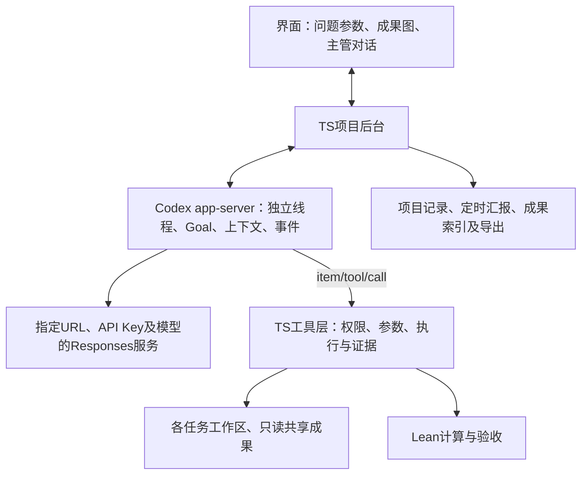

# Codex首版架构、模型配置与工具接入

日期：2026-10-25。状态：官方文档核验与设计示例。只使用Codex作为首版引擎，不新增Claude Code实现；没有安装、启动Codex、修改个人配置、调用模型或运行证明。

## 整体架构



界面只发送项目操作并展示结果。TS负责任务与线程关联、活跃Goal队列、角色权限、默认20分钟汇报、整理衔接和项目记录。Codex负责单会话执行、原生Goal续做及适用的Auto-review；Tool的实际业务执行由TS承接。

同类配置先由一个app-server管理多个独立线程，不为每个Agent启动一个完整桌面应用。不同provider或隔离策略需要分组时再增开受控服务进程；不预先假定百线程容量或逐请求限流已经解决。

主管、证明、汇报和整理使用独立会话。主管通过项目Tool列出、读取、调整工作任务；工作会话持有自己的Goal。汇报复用已有上下文，整理仍是一个独立Agent加一个独立工作区。现有流程见[TS封装](runtime-wrapper.md)和[汇报与成果图](reporting-workflow.md)。

## URL、API Key与模型如何传入

建议应用为Codex使用专属CODEX_HOME。其config.toml保存不含密钥的运行配置，API Key由TS从本机凭据配置取得后，通过子进程环境变量注入。专属配置目录用于分离会话与配置，不代表文件访问隔离。

下面只是配置示例，URL和模型名是占位符，尚未创建该配置：

```toml
model = "YOUR_MODEL_ID"
model_provider = "research"

approval_policy = "on-request"
approvals_reviewer = "auto_review"
sandbox_mode = "workspace-write"

[model_providers.research]
name = "Research model provider"
base_url = "https://provider.example/v1"
env_key = "RESEARCH_API_KEY"
wire_api = "responses"
requires_openai_auth = false

[features]
goals = true
shell_tool = false
multi_agent = false
```

base_url是API基础地址，通常由Codex追加/responses；不是任意网页地址，也不要把/chat/completions当作基础地址。env_key写的是变量名，真实值由TS只传给相应Codex子进程，不放到命题、工具输入、公开仓库或导出包中。

model_provider指向我们定义的research，不覆盖保留的openai等内置provider。这里主模型走自己的服务和API Key；这不保证该服务具备所有Codex功能。当前自定义provider的wire_api仅支持responses，必须验证流式工具调用与工具结果关联，不能只测普通文本回复。

[官方高级配置](https://learn.chatgpt.com/docs/config-file/config-advanced)说明CODEX_HOME和自定义provider；[配置参考](https://learn.chatgpt.com/docs/config-file/config-reference)列出上述字段。所用版本及组织策略可能限制有效配置。用户先前指定的OpenCode Go DeepSeek模型保持不变，实际协议兼容继续待验证。

## TS启动与建立任务

TS启动codex app-server，配置其工作目录和子进程环境，通过stdio收发请求与事件；不需要操作Codex桌面窗口。创建工作任务的顺序为：initialize并声明客户端能力 → initialized → thread/start登记线程和项目Tool → thread/goal/set设置目标 → turn/start启动首次执行。

之后让原生Goal继续工作，TS订阅事件更新项目视图，并通过线程和turn接口读取、分支、纠偏或中断。首次任务调用与Goal状态分别管理，不把一个turn结束当作整个目标结束。

[app-server文档](https://learn.chatgpt.com/docs/app-server)提供该接法，也支持按所选版本生成类型。动态Tool仍属实验接口，需要initialize的capabilities.experimentalApi为true。具体Tool消息字段以锁定版本生成的协议为准，不把历史样例当成永远不变的结构。

配置示例的multi_agent=false用于关闭模型自行扩张内置协作工具的路径；主管通过我们授予的管理Tool请求TS创建工作线程。它不等于禁止后台建立多个线程，也不是全局并发上限。业务并发继续按活跃Goal控制。

## Auto-review如何开启

示例中的三个关键条件是：on-request审批策略、auto_review审核器，以及仍可执行约束的沙盒边界。app-server读取这些有效配置；创建线程或turn时不得再用never或全访问覆盖成其他行为。

[官方Auto-review文档](https://learn.chatgpt.com/docs/sandboxing/auto-review)明确它处理符合条件的审批请求，已经允许的普通操作不逐项送审。开启后保留决策与拒绝原因；它不验证Lean证明，也不保证所有拒绝都能无人介入地解决。

审核模型的实际来源和外部provider兼容性需要单独观察。review_model配置针对/review代码审查，不是Auto-review审核模型开关；不能拿它来承诺指定权限判官。[CLI参考](https://learn.chatgpt.com/docs/cli/reference)另列approve-for-me快捷选项，但应用后台以显式配置为准。

本轮另复核一份2026-10-04提交的本地官方源码快照：同步审核的模型选择参考父模型元数据、首选审核模型及catalog，并存在父模型回退。它是历史实现证据，不能据此宣称2026-10-25任意提供商均已可用，也不把历史内部字段写成当前稳定配置项。

## 工具如何接入、如何替换

我们注册项目Tool的名称、用途和参数结构。Codex选择调用后，app-server把item/tool/call交给TS；TS验证会话身份、权限和参数，执行对应能力，再返回结果。不是由模型执行TS函数源码，也不需要增加MCP服务。

| 角色 | 拟暴露的主要项目Tool |
| --- | --- |
| 证明 | 项目文件读取/修改/搜索、Lean诊断与目标、skill搜索/只读打开、submit_skill |
| 主管 | 项目任务创建/调整、会话与进程状态查看、项目内证明文件读取、网上调研 |
| 汇报 | 上下文和文件快照读取、有限的结构化汇报及受限模块提交 |
| 整理 | 自己工作区读写、共享库搜索、Lean验收、可用目录及结构化结果提交 |

Tool以业务能力配置，具体名字和参数未定。路径根目录、会话身份和权限来自TS登记，不能相信模型在参数里自报角色。写操作只允许自己的工作区；共享skill和冻结输入只读，越界及符号链接解析都由受信文件层检查。

“接入”与“替换”分开处理：

1. dynamicTools能接入我们的能力，但不会因为出现同名read/write就自动替换所有内置能力；使用不冲突的项目工具名称。
2. 官方features.shell_tool=false可关闭命令执行工具。无需通过提示词要求模型不要使用shell。
3. 完整工具清单仍要逐项确认，包括补丁、文件、浏览与扩展入口。本轮未查到一个稳定的“仅保留这个数组”总开关，不能宣称该示例已经只剩项目工具。
4. 官方[Hooks文档](https://learn.chatgpt.com/docs/hooks)支持在PreToolUse对覆盖到的调用明确拒绝，但回调报错、超时或格式错误可能不阻止执行，因此不能仅靠hook承诺硬白名单。它可以作为补充控制，不能把它描述成任意Tool的原子替换接口。
5. 若锁定版本无法通过配置形成所需最小工具集合，才评估小范围工具注册层适配；不立即fork整套Codex，不改模型协议或另写Goal循环。

历史快照中，Shell与apply_patch的注册条件分别处理，也提醒我们不能从shell开关推断所有文件变更入口已经关闭。该观察未运行验证，当前版本行为以接入检查为准。

## Auto-review与自定义Tool的边界

内置审核处理Codex认识的审批路径。官方动态Tool文档没有证明所有item/tool/call都会自动成为Auto-review请求。

因此项目文件和Lean工具首先由TS按明确权限确定性执行；不能把审批逻辑省略后认定原生审核会兜住。也不因为这个边界就另造一整套模型判官。若未来的某个自定义Tool需要原生自动审核，必须找到并验证受支持的审批接缝，不伪造升级命令来触发审核。

本数学首版的目标是：文件范围由项目Tool强制执行；原生Auto-review处理实际存在且符合条件的Codex审批。两者分别记录覆盖范围。

## 首次接入应核对的结果

后续获准实施时，先验证一个线程：使用指定URL和模型真实调用项目Tool；确认实际工具清单与残留内置入口；观察Goal续做；单独触发一项合格审批检查Auto-review及其实际审核模型；最后测试暂停和20分钟分支汇报。

不能用改好了配置、模型列在菜单里或普通聊天成功，代替完整链路验证。本轮仅整理设计和示例，没有改动个人CODEX_HOME、使用真实API Key、启动app-server、写产品代码或运行相关测试。
