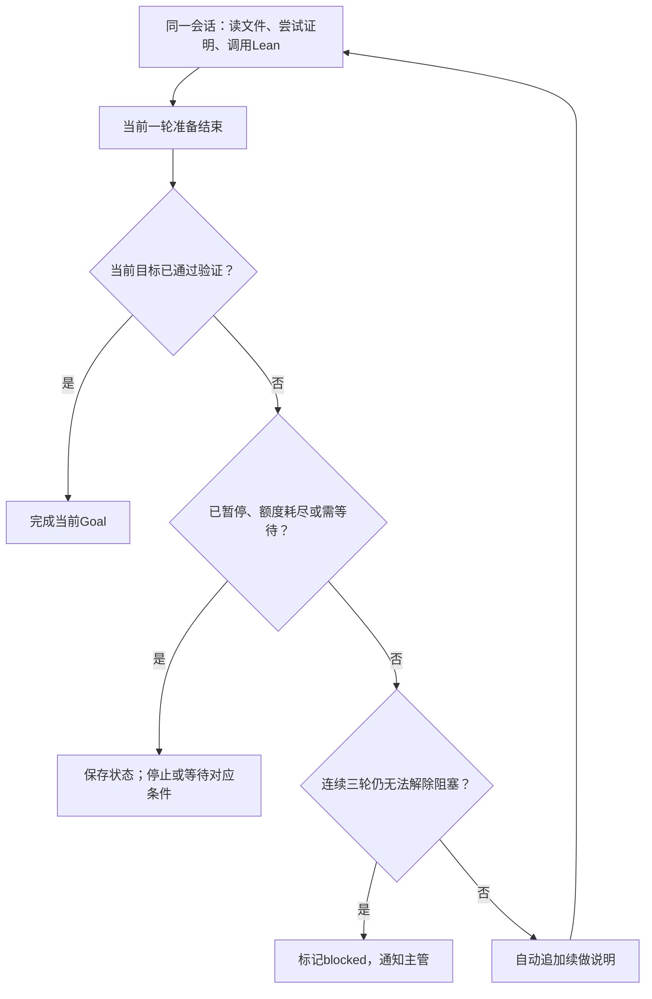

# 单个Agent持续证明

日期：2026-10-24。状态：设计方案与源码调研；尚未安装Goal插件、编写产品代码或运行证明。Pi SDK已确定，具体Goal插件和版本尚未确定。当前先解决单Agent续跑，其他Pi功能和外围技术选型随后逐点讨论。

## 要实现的行为

用户提交问题后，主管给工作Agent分配明确目标。工作Agent在同一会话和工作区内持续尝试，不因一次普通回答结束、一次Lean报错或暂时没有新证明就交回用户。

默认20分钟汇报独立于续跑。汇报读取确定上下文截止点并追加一句结构化输出要求，原证明继续；汇报会话不继承父会话的活动Goal、自动续跑状态和写权限。

## 核心循环

目标未完成且仍有允许范围内的动作时，续做说明要求Agent选择下一项实际动作，例如修复诊断、查找适用引理或尝试另一条路线。继续沿用会话和文件，不每轮重新创建Agent，不把整个研究方向重新分解一次。

续做消息由运行系统产生，应明确其来源；它不代表用户新回复、确认或扩大权限。

## 使用Pi已有能力

Pi的[扩展文档](https://github.com/earendil-works/pi/blob/main/packages/coding-agent/docs/extensions.md)提供agent_before_settle边界，可以追加条目并请求一次下一轮调用。agent_end只是一次底层运行结束，后面可能还有重试或压缩；agent_settled是最终通知，不能当作所有续跑方式的同一个触发点。

现成[pi-goal](https://github.com/Michaelliv/pi-goal)已实现会话目标、自动续做、暂停恢复、预算统计和会话内状态保存。其当前源码在agent_end后经follow-up队列追加续做消息。另一个[pi-goal-x实现](https://github.com/fractaal/pi-extensions/tree/main/packages/goal-x)先等待ctx.onIdle，再追加续做消息；不能把两者描述成同一套事件实现。

建议复用现成Goal的同会话续跑和持久化机制，并适配本项目的完成与阻塞规则。只让一个机制负责自动续跑；避免同时开启Goal插件、另一个结束事件监听器和定时“继续”任务，产生重复请求。具体插件及可维护的适配方式，见[Goal实现调研](pi-goal-implementations.md)。

若选定Pi版本支持agent_before_settle，应按该版本的事件与上下文契约设计续做；使用现成插件时先核对它实际使用的生命周期接口。此处未承诺任意插件可以原样放入当前SDK。

## 完成必须对应实际目标

Agent调用完成工具只是提出完成请求。项目应检查当前分配的命题、前提、文件版本和Lean环境，并取得受信验证结果后再关闭Goal。编译退出码不单独代表完成，既有关于sorry、公理及目标一致性的验收约定继续有效。

工作Agent完成自己分配的子Goal后，交由主管复用成果或分配下一项工作。主问题未完成不意味着要继续重复证明已经解决的同一个子Goal。

持续调用、改文件和大量平凡引理都不能代替主目标进展。上下文接近上限时复用Pi的压缩能力；冻结命题、证明源码与验证证据仍从项目文件读取，不能只依赖摘要。

## 用户明确的三轮阻塞规则

只有同一Goal连续三轮自主排障后，仍无法解除阻塞，才转为blocked并产生交给主管的阻塞事件。前两轮保持运行，工作Agent自行修复或换方法。阻塞解除后，连续计数清零。

“一轮”是一次有记录的Goal续做与排障尝试，不是一次Tool错误、一次API重试、等待外部计算，或一次没有新证明的汇报。同一轮重复调用阻塞工具只计一次。单纯重启不能抹掉已记录的连续计数。

阻塞记录至少包括：当前Goal、阻塞事实、证据、已经尝试的处理，以及解除条件。第三轮前不发布blocked状态或阻塞告警；原始记录和正常进度继续保存，主管既有的会话及文件查看能力保留。

三轮规则应写入受信工具和状态转换，而不是只放进提示词。原版插件若一次阻塞调用就暂停，应在该转换之前适配，不能先暂停再把告警藏到第三次。主管处理后可调整路线、补充条件或恢复任务。

## 暂停、错误与预算

用户暂停优先：先保存暂停状态并取消后续自动续做，再中止当前调用，避免中止事件触发新的证明轮次。普通网络错误按既有策略退避，永久性配置问题保留原因等待处理；不得用自动续跑掩盖失败并高速重试。

Goal插件的单会话用量统计与项目总额度分别管理，证明、主管、汇报、整理及上下文压缩都消耗模型资源。调度额度应按每次模型请求和计算任务分别控制，而非让一次可能持续数小时的会话一直独占一个请求名额。

本机调度需要应用进程运行及机器保持唤醒。Mac休眠时本机无法继续安排模型请求；已提交远端的计算按执行服务自身规则运行。

## 后续实现时只验证一条小链路

先验证一个会话：普通结束后自动继续、复用文件和上下文、目标验证后结束、连续三轮阻塞才上报、用户暂停后不再自动发请求，以及重开后能恢复正确状态。然后再接20分钟独立汇报和多Agent调度。

以上为未来验收范围，本轮没有运行这些检查。GUI、SQLite、Lean部署位置和完整Pi功能接入另行逐点收敛，不作为本次续跑设计的前置条件。
