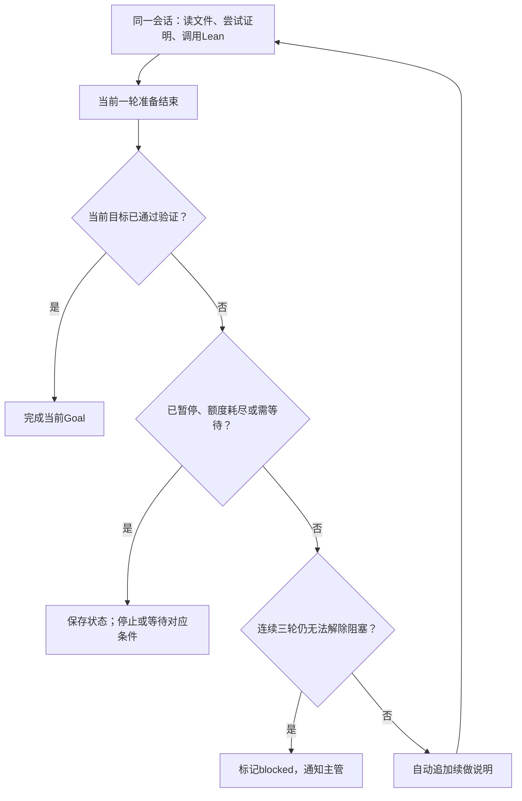

# 单个Agent持续证明

日期：2026-10-24。状态：设计方案与源码调研；尚未安装Goal插件、编写产品代码或运行证明。用户已改选Codex，拟复用原生Goal与自动权限审核，不再推进Pi插件集成。当前先核验外部模型、Goal与审核能否共同运行，其他选型随后逐点讨论。

## 要实现的行为

用户提交问题后，主管给工作Agent分配明确目标。工作Agent在同一会话和工作区内持续尝试，不因一次普通回答结束、一次Lean报错或暂时没有新证明就交回用户。

默认20分钟汇报独立于续跑。汇报读取确定上下文截止点并追加一句结构化输出要求，原证明继续；汇报会话不继承父会话的活动Goal、自动续跑状态和写权限。

## 核心循环

目标未完成且仍有允许范围内的动作时，续做说明要求Agent选择下一项实际动作，例如修复诊断、查找适用引理或尝试另一条路线。继续沿用会话和文件，不每轮重新创建Agent，不把整个研究方向重新分解一次。

续做消息由运行系统产生，应明确其来源；它不代表用户新回复、确认或扩大权限。

## 使用Codex原生Goal

[Codex官方Goal说明](https://developers.openai.com/cookbook/examples/codex/using_goals_in_codex)提供持久线程目标、用量和生命周期。当前一轮结束、没有待处理输入且线程空闲时，运行时决定是否续做。项目不另写定时“继续”循环，不叠加Pi Goal插件。

[app-server](https://learn.chatgpt.com/docs/app-server)提供thread/goal/set、get、clear与Goal更新事件，TS后台可以通过接口管理目标。原生机制已有不等于指定第三方模型组合已经验证；模型协议与自动审核条件见[Codex与Claude Code比较](codex-integration.md)。

[Auto-review](https://learn.chatgpt.com/docs/sandboxing/auto-review)决定操作是否获准，Goal决定是否继续，Lean证据决定数学产物是否成立。这三个职责分别保留；原生权限审核不能替代领域验收。

此前[Pi Goal源码调研](pi-goal-implementations.md)保留作历史学习资料，不作为当前实现依赖。

## 完成必须对应实际目标

Agent调用完成工具只是提出完成请求。项目应检查当前分配的命题、前提、文件版本和Lean环境，并取得受信验证结果后再关闭Goal。编译退出码不单独代表完成，既有关于sorry、公理及目标一致性的验收约定继续有效。

工作Agent完成自己分配的子Goal后，交由主管复用成果或分配下一项工作。主问题未完成不意味着要继续重复证明已经解决的同一个子Goal。

持续调用、改文件和大量平凡引理都不能代替主目标进展。上下文接近上限时复用Codex的压缩能力；冻结命题、证明源码与验证证据仍从项目文件读取，不能只依赖摘要。

## 用户明确的三轮阻塞规则

只有同一Goal连续三轮自主排障后，仍无法解除阻塞，才转为blocked并产生交给主管的阻塞事件。前两轮保持运行，工作Agent自行修复或换方法。阻塞解除后，连续计数清零。

“一轮”是一次有记录的Goal续做与排障尝试，不是一次Tool错误、一次API重试、等待外部计算，或一次没有新证明的汇报。同一轮重复调用阻塞工具只计一次。单纯重启不能抹掉已记录的连续计数。

阻塞记录至少包括：当前Goal、阻塞事实、证据、已经尝试的处理，以及解除条件。第三轮前不发布blocked状态或阻塞告警；原始记录和正常进度继续保存，主管既有的会话及文件查看能力保留。

三轮规则作为业务要求保留。Codex现成Goal是否能经宿主直接约束该转换，需要核验锁定版本；只在提示词写三轮不等于程序保证。权限审核的三次拒绝熔断与证明阻塞是不同计数，不能混用。主管处理后可调整路线、补充条件或恢复任务。

## 暂停、错误与预算

用户暂停优先：先保存暂停状态并取消后续自动续做，再中止当前调用，避免中止事件触发新的证明轮次。普通网络错误按既有策略退避，永久性配置问题保留原因等待处理；不得用自动续跑掩盖失败并高速重试。

Codex的单线程用量与项目总额度分别管理，证明、主管、汇报、整理及上下文压缩都消耗模型资源。模型请求与计算任务需分别控制。Codex Goal内部续做会自行发起请求，首版应验证项目活跃任务上限如何约束它，不能沿用Pi的请求接入设想就认定已有全局逐请求限流。

本机调度需要应用进程运行及机器保持唤醒。Mac休眠时本机无法继续安排模型请求；已提交远端的计算按执行服务自身规则运行。

## 后续实现时只验证一条小链路

先验证一个会话：普通结束后自动继续、复用文件和上下文、目标验证后结束、连续三轮阻塞才上报、用户暂停后不再自动发请求，以及重开后能恢复正确状态。然后再接20分钟独立汇报和多Agent调度。

以上为未来验收范围，本轮没有运行这些检查。先确认指定模型、原生Goal和Auto-review的组合可用，再进入实现；GUI、SQLite及Lean部署位置另行逐点收敛，不作为本次续跑设计的前置条件。
