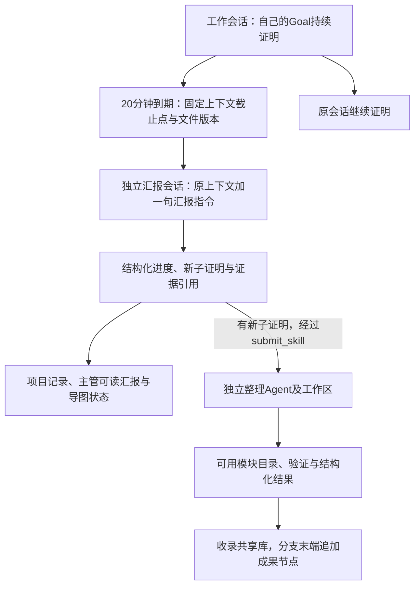

# TS如何封装Codex与Claude Code的Goal任务

日期：2026-10-24。状态：官方接口核验与封装设计，未写产品代码、安装依赖、启动服务或调用模型。范围仅为Codex和Claude Code；不再推进Pi。当前Codex优先决定保留，本次同时梳理两个后端如何承载同一产品流程，不要求首版实现两个后端。

## 封装的单位

每个业务工作Agent对应一个独立、可恢复的引擎会话和自己的Goal。这里的“子Agent”是我们管理的工作会话，不默认等于CLI内置Agent工具临时生成的子进程或子会话。这样主管可以逐个分配方向，后台可以直接观察和暂停每个Goal。

每次尝试关联：任务ID、引擎会话ID、工作区、模型配置引用、Goal与验收条件、运行状态和事件位置。Goal完成与数学成果验收分别保存；主管、工作、汇报、整理共用会话接入能力，以任务和Tool权限区分角色。

## TS只提供一套业务入口

下列是建议的项目能力名称，不是已经实现的API，也不是两个引擎恰好同名的接口。

| 能力 | 调用方得到什么 |
| --- | --- |
| 启动任务 | 独立会话、目标、工作区和运行标识 |
| 观察任务 | 实时文本、工具执行、等待、Goal状态及用量事件 |
| 读取任务 | 已保存的历史、当前状态及对应文件；不唤醒Agent |
| 调整任务 | 给原会话补充方向，或在安全边界更新目标 |
| 暂停、续接、取消 | 停止后续续做，保存状态，再按明确请求恢复 |
| 分出汇报 | 从指定上下文截止点建立独立汇报任务并返回结构化结果 |

业务层只依赖这些能力。Codex/Claude的命令、事件名称和历史格式由各自适配部分处理；不在导图、成果库和整理流程中散落引擎判断。首版不实现通用插件平台。

## TS如何调用

### Codex

建议TS启动一个受控的codex app-server，通过stdio交换结构化请求和事件，不操作桌面窗口。接口版本随所用Codex锁定，类型可由该版本工具生成。

典型流程是：初始化连接 → thread/start建立线程 → thread/goal/set登记目标 → turn/start发出首次任务 → 持续接收事件。后续自动续做交给原生Goal；TS不再定时给它发送“继续”。读取、分支、纠偏和中断分别使用对应线程及turn接口。

[官方app-server文档](https://learn.chatgpt.com/docs/app-server)提供上述线程、Goal及流式控制能力；[SDK说明](https://learn.chatgpt.com/docs/codex-sdk)也区分自建完整客户端和普通自动化任务的接法。本项目的GUI需要历史、权限与进度，因此优先app-server。一个服务可以管理多个线程，但本项目未测容量。

### Claude Code

官方明确支持在非交互CLI中启动/goal，并用stream-json持续输出。因此保证复用CLI Goal的保守接法是：TS以子进程参数启动claude -p，任务为/goal加明确完成条件，持续消费结构化输出。无需打开终端窗口，也不在TS重写续跑循环。

[Claude Goal文档](https://code.claude.com/docs/en/goal)和[程序化运行说明](https://code.claude.com/docs/en/headless)支持该路径。TS也可用Agent SDK的query消费消息；SDK具体版本是否原样处理/goal，应先验证，不能只因SDK有普通Agent循环就当作Goal已启用。若SDK路径不提供该能力，保留官方CLI接法作为同一个适配器的实现。

SDK仍运行Claude Code二进制，不是纯网络模型请求。[SDK概览](https://code.claude.com/docs/en/agent-sdk/overview)说明了这一点。并行多个活动运行会引入相应运行时开销；不能沿用Pi异步会话的内存假设，或保证100个活跃运行适合Air。

## 指定我们的模型

任务引用provider配置与完整model ID；配置中的地址、凭据来源、协议和非敏感参数由适配器传给引擎，不由GUI直接调用模型。

| 配置 | Codex | Claude Code |
| --- | --- | --- |
| 工作模型 | 线程/turn模型及自定义provider | model选项或CLI的--model |
| 外部服务 | provider的base_url和凭据来源，当前要求Responses | 支持的provider或兼容网关，常用Anthropic Messages接法 |
| 汇报、整理模型 | 对相应独立会话指定模型 | 对相应独立运行指定模型 |
| 内置Goal评估或权限reviewer | 只使用引擎实际提供的配置；不得假设随工作模型一起改变 | Goal评估使用小模型配置，权限分类器另有选择和可用性规则 |

工作、汇报与整理默认可以引用相同模型配置。原生Goal评估器和安全审核模型属于额外调用，不能用一个“审查模型”字段承诺统一替换所有内部模型；保存实际使用信息和失败原因。

[Codex配置](https://learn.chatgpt.com/docs/config-file/config-reference)、[Claude模型配置](https://code.claude.com/docs/en/model-config)及[权限模式](https://code.claude.com/docs/en/permission-modes)是配置依据。指定模型的协议接法及审核兼容性继续按[前次调研](codex-integration.md)处理；本次不换掉OpenCode Go的deepseek-v4.1-flash，也不重复扩大选型讨论。

## 并发由TS控制活跃任务

需要区分三件事：登记了多少Agent、同时活跃多少Goal、同时执行多少计算作业。登记100个Agent不要求同时启动100个活动运行。

首版建议用任务队列与固定活跃槽位：获得槽位才激活Goal；完成、暂停、取消或结束后释放。证明、汇报、整理和主管使用同一总额度下的角色配额，为主管和短汇报保留容量，避免长时间证明占满全部名额。

示例可登记100个工作Agent，同时激活8个证明Goal，另外保留汇报、整理与主管名额。这只是说明调度含义，不是硬件或套餐实测参数。排队Agent在界面明确显示排队，不显示正在证明。若要100个方向都轮流推进，需要在安全边界按工作时间窗轮换，保留Goal和会话续接；长Goal不能永远占住名额。暂停/恢复的可靠边界属于接入验证范围。

只限制Promise.all或一次turn/start的发起数量不够：原生Goal会自己发出后续请求。活跃槽应覆盖该Goal的连续工作阶段，而非第一次调用返回就释放。内置子Agent数量设置也不是本项目全部独立会话的全局限制。

活跃Goal数仍不等于精确HTTP并发数，Goal评估、自动审核、压缩等可能带来额外模型请求。若以后要求所有内部请求都严格受同一请求限额控制，应由兼容的模型网关或引擎支持的请求层实现；不要借此在首版重写Goal。Lean等计算作业另设队列。

项目累计预算不能仅依赖恢复后可能重置的引擎单次运行用量。根据实际用量保存项目累计值，限流、认证故障和等待计算与证明阻塞分别记录。

## 查看执行过程和正在做什么

实时观察以事件为依据，不让另一个模型不停读全文来猜Agent是否活着。

| 需要显示 | 依据 |
| --- | --- |
| 当前分配方向 | 主管登记的任务和Goal |
| 当前运行或等待 | 引擎状态、模型请求与工具作业事件 |
| 正在读、改或检查什么 | Tool名称、输入范围和实际执行状态 |
| 最近做了什么 | 已完成Tool、文件版本、Lean结果及Agent公开说明 |
| 有无研究进展 | 验证证据与定时报告；不以消息量推断 |

Codex提供item、turn、线程状态与计划/差异事件。Claude的[流式输出](https://code.claude.com/docs/en/agent-sdk/streaming-output)提供消息和Tool请求，配合[PreToolUse、PostToolUse及失败hooks](https://code.claude.com/docs/en/agent-sdk/hooks)观察实际调用结果。Tool参数输出结束不代表工具执行结束，工具结束也不等于证明成功。

TS把不同引擎事件转换成项目视图，同时保留原始记录与时间。显示任务持续时间、当前动作耗时和最近证据时间；模型服务未提供的信息就显示未知。无需、也不能保证取得模型隐藏思维或服务端内部执行状态。

主管用项目Tool列出工作会话、被动读取历史与状态、读取证明文件并检查方向；不会为了查看状态而对每个工作会话发一条新消息。需要纠偏才发送任务消息。Codex有turn/steer；Claude可通过持续输入或恢复指定session传入新指令。具体中途输入方式按锁定版本核验。

## 默认20分钟如何clone汇报

不先让工作Agent重写摘要。定时器向队列提交汇报任务，复用该截止点的原上下文，仅追加既定的一句输出要求。没有新子证明时列表为空；后端持久化报告后，主管通过收件队列或查看Tool取得结果，不必每20分钟打断主管正在进行的回复。

Codex使用thread/fork；可按lastTurnId固定到一个已完成turn。正在进行的turn不能作为该参数；不指定截止turn的中途fork会保存中止标记。Claude SDK使用resume加forkSession，原会话记录保持独立。其[会话文档](https://code.claude.com/docs/en/agent-sdk/sessions)明确fork只复制对话历史，不复制文件系统；多会话必须指定session ID，不能用“继续最近会话”猜目标。

20分钟是触发时间，不是保证所有待处理Tool都在该时刻结束。适配器应记录实际上下文截止点，不能把尚未结束的调用包装成完成。若只可复制很早的完整turn，不能把报告称为当前完整状态；需验证中途fork能否保留最新已提交上下文并安全整理。Claude的精确截止点控制、活跃会话分支和Goal继承细节同样待锁定版本核验，不手工篡改原始历史文件来伪造支持。

汇报启动前必须保证它不会继承证明Goal或自动续做；使用只读文件快照和一次有限任务。若统一按Goal管理汇报，则给它独立的短Goal：“输出本次结构化报告即结束”。不能把证明Goal复制过来让汇报Agent继续证明。分支的配置应在首次推理前生效；原子设置或禁用继承的具体方式是必须验证的接缝，不能只在提示词写“请不要继续”。

报告Schema由TS校验。Claude SDK有outputFormat，CLI有json-schema；Codex按所用turn输出约束处理。它们是结构要求，不能证明内容为真。缺失、超时或不合法结果标为汇报失败并有限重试，不更新成功状态，也不影响原工作Goal。多个到期报告排队，不同时突发启动100个运行。

## 汇报与子模块整理分别做

报告负责描述截止点已有进度。子模块整理仍由一个独立Agent在自己的工作区执行：检查已有成果、尽量补齐修正、调用Lean核验、形成可复用文件夹和结构化结果，不默认退回原证明Agent。

submit_skill提交目录的固定版本，不能把工作中的可变目录直接当成整理输入。报告发现新子证明时可以在只读权限外仅拥有这项受限提交能力，或由后台依据报告证据调用同一提交入口；两条来源使用相同提交标识，避免工作Agent已提交的同一版本重复启动整理。

整理Agent的Goal绑定“交付当前命题对应的可用模块及证据”，不能改原命题来迎合完成条件。其结果经受信收录流程后，才增加图节点。普通报告只更新状态；无新证明不新增成果节点。

## 主管、工具和记录沿用原流程

主管通过项目Tool分配或调整方向；TS负责创建会话、限制名额、执行角色权限、保存事件和更新界面。主管不需要理解两套底层协议，不把每次事件都灌入主管上下文。

直接Tool配置仍是产品接口。Codex动态Tool当前为实验能力；Claude SDK的标准自定义Tool登记内部使用进程内MCP封装，不需要独立网络服务。这是所查SDK的接口事实，不是本项目新增MCP平台或改变用户已有约定；若完全不接受该内部接法，应在实施前明确该后端不具备所需直接Tool路径。

文件范围继续由受信Tool或宿主执行，cwd、Goal和clone均不代替访问限制。独立整理区、只读共享skill及冻结输入保持原约定；复杂三端沙盒不在本轮展开。

同一Goal连续三轮自主排障仍受阻才上报主管的要求保留。一次工具报错、API重试或报告无新成果都不自动计为一轮。原生权限审核熔断与证明阻塞分别处理；精确三轮规则不能仅凭“引擎有Goal”就认定实现。

[记录与导出](records-and-export.md)继续保存原始会话、任务/Goal关联、汇报截止点、模块文件及验证、项目图和续接信息。跨机恢复先停止旧机新调度并导出一致快照，凭据单独配置；原生会话能恢复不代表正在执行的进程、缓存或外部计算自动迁移。

## 实施前只核验这些接缝

1. 指定provider/model真实完成Tool调用，原生Goal跨轮续做。
2. TS限制活动运行，Goal内部续做不绕过活跃任务槽；暂停后不会自动重启。
3. 过程事件可对上实际Tool结果和文件版本，读取历史不启动新工作。
4. 活跃证明期间分出汇报，保留正确上下文，原证明继续，汇报不继承证明Goal。
5. 结构化报告、submit_skill和独立整理形成一条有实际证据的链路。
6. 保存、重启、原会话续接及项目累计用量正确。

以上是未来验证要求，本轮未执行。不会因查到接口就宣称两个后端已完整等价，或已支持Air百Agent运行。
